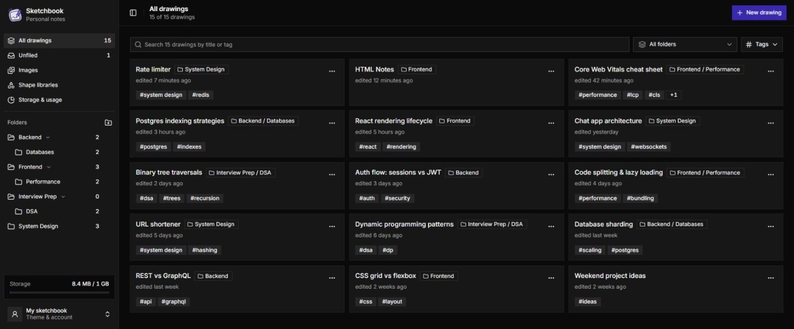

# Sketchbook

A self-hosted notebook for [Excalidraw](https://excalidraw.com) drawings.
Keep your sketches, diagrams and visual notes in your own Postgres database,
organised in nested folders with tags and search, behind a single password.
It runs free on Vercel + Neon.



## Features

- **Excalidraw editor** with autosave about 1.5 s after you stop drawing.
- **Nested folders.** Drag drawings and folders between them, or use the
  _Move to…_ dialogs on touch screens. Collapsed folders are remembered.
- **Tags and search** across titles and tags, with a folder filter.
- **Images.** Pasted screenshots are compressed to WebP and stored in the
  database; an _Images_ page shows every image across all drawings.
- **Shape libraries** from [libraries.excalidraw.com](https://libraries.excalidraw.com),
  added once and available in every drawing.
- **Storage & usage** page with a breakdown of what takes up space.
- **Light and dark mode**, mobile layout, and installable as a home-screen
  app (PWA manifest).

## How it works

Sketchbook is a single-user app: one password (`APP_PASSWORD`) unlocks
everything. There are no accounts or sharing.

| Piece       | Where                                                                                                        |
| ----------- | ------------------------------------------------------------------------------------------------------------ |
| Login       | `src/proxy.ts` guards every page and API; `/api/login` checks `APP_PASSWORD` and sets a signed 30-day cookie |
| Library     | `/` loads folders + drawings in one call (`/api/library`) and filters in the browser                         |
| Editor      | `/d/[id]` loads the scene, then each image separately; autosaves after you stop drawing                      |
| Images      | one row per image in `drawing_files`; removed images are pruned on save                                      |
| Size limits | Vercel caps a request/response at 4.5 MB, so images go one per request                                       |

**Stack:** Next.js 16 (App Router) · React 19 · `@excalidraw/excalidraw` ·
Prisma 7 · PostgreSQL (Neon or any Postgres) · Tailwind CSS 4 + shadcn/ui ·
TanStack Query · dnd-kit · zod · jose.

## Run locally

You need Node.js 20.9 or newer and a PostgreSQL database. Any Postgres works:
Neon URLs use Neon's serverless driver, anything else uses the standard `pg`
driver (`src/lib/db.ts`).

```bash
git clone https://github.com/rahulkumar215/sketchbook.git
cd sketchbook
npm install
cp .env.example .env   # then fill it in (see below)
npx prisma migrate deploy
npm run dev
```

Open http://localhost:3000 and sign in with your `APP_PASSWORD`.

### Environment variables

| Variable         | What it is                                                                                   |
| ---------------- | -------------------------------------------------------------------------------------------- |
| `DATABASE_URL`   | Postgres connection string the app uses (on Neon, the **pooled** URL)                        |
| `DIRECT_URL`     | Non-pooled connection string for Prisma migrations (on any other Postgres, same as above)    |
| `APP_PASSWORD`   | The password for signing in. Use a long one.                                                 |
| `SESSION_SECRET` | 64 hex characters that sign the login cookie (generate one with the command below the table) |

```bash
node -e "console.log(require('crypto').randomBytes(32).toString('hex'))"
```

## Deploy to Vercel + Neon

[](https://vercel.com/new/clone?repository-url=https%3A%2F%2Fgithub.com%2Frahulkumar215%2Fsketchbook&env=DATABASE_URL,DIRECT_URL,APP_PASSWORD,SESSION_SECRET)

1. Create a free database at [neon.tech](https://neon.tech) and copy its
   pooled and direct connection strings.
2. Click **Deploy with Vercel** above (or import your fork in Vercel) and
   fill in the four environment variables.
3. Deploy. Production builds run `prisma migrate deploy`
   (`scripts/migrate.mjs`), so the tables are created on the first deploy
   and later schema changes apply automatically.

**Preview deployments don't migrate.** Vercel builds every branch and pull
request as a Preview, often with the same database variables as Production,
and migrating there would apply an unmerged branch's schema to your real
database. So Preview builds skip migrations. To have previews migrate, point
the Preview environment at a separate database (for example a
[Neon branch](https://neon.tech/docs/introduction/branching)) and set
`RUN_MIGRATIONS=true` for Preview. The check relies on Vercel's `VERCEL_ENV`
variable; if you turned off _Automatically expose System Environment
Variables_, every build migrates.

The storage meter assumes a 1 GB limit. Change `STORAGE_LIMIT_BYTES` in
`src/lib/types.ts` to match your database plan. Check the current free-tier
limits of [Neon](https://neon.tech/pricing) and
[Vercel](https://vercel.com/pricing); Vercel's Hobby plan is for
non-commercial use.

## Changing the schema

Edit `prisma/schema.prisma`, then run
`npm run db:migrate -- --name what_changed` and commit the new folder under
`prisma/migrations/`.

## Credits

- [Excalidraw](https://github.com/excalidraw/excalidraw) (MIT) does all the
  drawing.
- The default shape libraries come from
  [libraries.excalidraw.com](https://libraries.excalidraw.com) (MIT), by
  their respective authors.

## License

[MIT](LICENSE)
